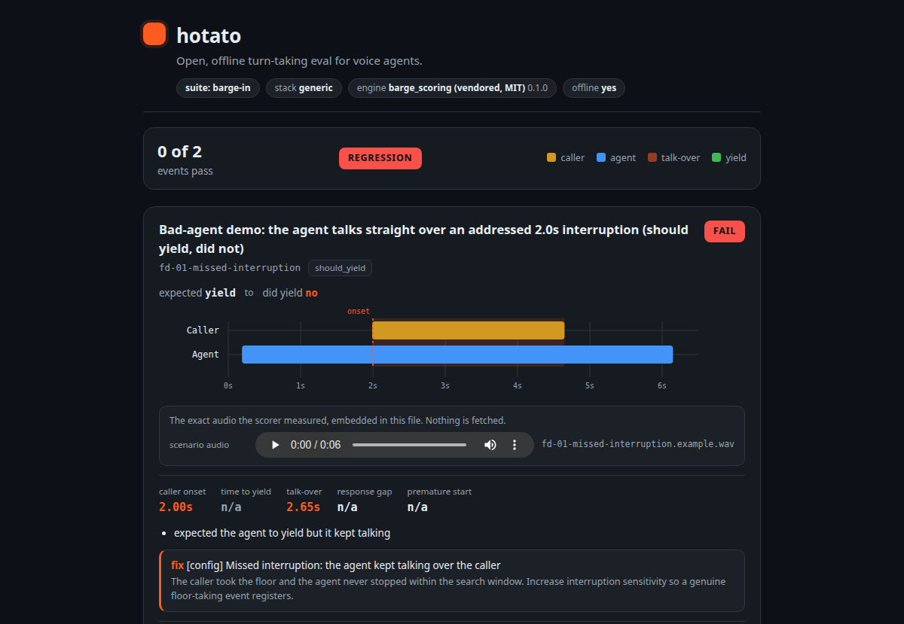

<div align="center">

<picture>
  <source media="(prefers-color-scheme: dark)" srcset=".github/assets/hotato-banner-dark.svg">
  
</picture>

<p>
<a href="https://pypi.org/project/hotato/"></a>
<a href="https://pypistats.org/packages/hotato"></a>
<a href="https://pypi.org/project/hotato/"></a>
<a href="https://github.com/attenlabs/hotato/actions/workflows/tests.yml"></a>
<a href="https://github.com/attenlabs/hotato/blob/main/LICENSE"></a></p>
<!-- Stars badge (shields.io github/stars/attenlabs/hotato): add once the repo passes ~25 stars. -->

# hotato

**Hotato simulates, monitors and gates voice agents in CI. Open source, local-first, with a hosted option.**

Find what broke in your agent calls. Pin it and CI stays red until you fix it.



```bash
pip install hotato
hotato check --demo             # a bundled failing call: what broke, and when
hotato check ./call.wav         # then your own recording
hotato vapi health              # or your last 100 Vapi calls
```

Zero config. Vapi, Retell, Bland, Synthflow, Millis, or local audio.
Works with any recording: mono, dual-channel, or a transcript. Timing math, not a judge. Offline. Free. MIT.

**[hotato.dev](https://hotato.dev)**

</div>

## What it finds

| Failure | What hotato measures |
| :-- | :-- |
| **Say-do gap** | The caller interrupts to cancel (a barge-in), the agent says "canceled", the booking tool fires anyway: turn timing from the audio, the tool call from your OTel trace. |
| **Latency spike** | The pause before a reply going from 800 ms to over 2 s. |
| **Dead air** | That pause reaching 5 s, or the line going quiet. |
| **Talk-over** | The agent starts a fresh utterance over the caller. |

## Quickstart

### Vapi

```bash
pip install hotato
export VAPI_API_KEY=...
hotato vapi health --last 7d --output report.html
```

Open `report.html`: every critical incident, timestamped, and your Voice Stability Score.

### Retell

```bash
export RETELL_API_KEY=...
hotato retell health --last 7d
```

It lists your recent Retell calls, or takes `--call-id` (repeatable) to name them.
`hotato bland health`, `hotato synthflow health`, and `hotato millis health`
follow the Vapi shape. Those stacks mix both voices onto one channel, so
they measure silence timing, dead air and latency gaps, each finding with
its measured confidence; barge-in and talk-over need two channels.

### Local audio

```bash
hotato autopsy ./call.wav
```

Writes a self-contained HTML report to `hotato-output/`, plus the JSON
`pin` reads. Open the HTML in your browser.

## From finding a bug to gating on it

`autopsy` turns one recording into timestamped incidents. `scan` reads a
folder and tracks the trend. When you are ready, move a finding into CI:
`hotato pin` turns one incident into a portable failure check, and `hotato
prove` re-runs every stored check and fails the build rather than pass on
evidence it cannot re-read. Every verdict carries its own evidence across
five dimensions: outcome, policy, conversation, speech, reliability.

A pinned check re-measures its own stored recording, so it holds the build
red on that bug and catches an edited bundle, a loosened policy, or an
engine upgrade that scores the same bytes differently. Clearing it takes a
fresh recording of the same moment against the current agent: `hotato drive
<bundle>` places that call on Vapi or Twilio, and
[`docs/RECAPTURE.md`](docs/RECAPTURE.md) is the walkthrough for every other
stack.

[Pin a bug →](docs/CI.md)

For continuous use: run `hotato vapi health` on a schedule, and open
`hotato console --production-db evidence.db` to watch calls land live.

## Wire it into CI

The exit code **is** the verdict: `0` pass, `1` fail, `2` refuse (could not tell).

```yaml
# .github/workflows/voice-qa.yml
on: [pull_request]
jobs:
  hotato:
    runs-on: ubuntu-latest
    steps:
      - uses: actions/checkout@v4
      - uses: attenlabs/hotato@v1.22.0
        with:
          contracts: contracts/
          hotato-version: 1.22.0
```

`contracts/` holds what `pin` wrote. Full workflow: [`docs/CI.md`](docs/CI.md).
Add `comment-pr: true` (with `pull-requests: write`) and each pull request gets
one comment, updated in place: the verdict, what failed with its evidence, what
the change fixed or broke against the base branch, and links to the Failure
Records and evidence cards ([`docs/PR-COMMENT.md`](docs/PR-COMMENT.md)).

## Point your agent at it

Point Claude Code, Cursor, or any coding agent at this repo: it reads
[`AGENTS.md`](AGENTS.md) and runs the loop end to end offline, no key. Over local
stdio the MCP server adds the scorer plus read/verify/propose tools:
`uvx --from "hotato[mcp]" hotato-mcp` ([`docs/MCP.md`](docs/MCP.md)). Deploying is yours.

## Nothing leaves your machine

hotato runs offline, on the machine that invokes it. The core is stdlib-only
Python: no account, no key, no network call of its own. Your traces, prompts,
and audio stay on your disk. Scoring with a language model you host yourself
is a separate opt-in add-on, outside that core.

## Go deeper

The whole loop, command by command: [`docs/LIFECYCLE.md`](docs/LIFECYCLE.md).
First touch to a CI gate: [`docs/GETTING-STARTED.md`](docs/GETTING-STARTED.md).
Feed it what you already have: [`docs/CONNECT.md`](docs/CONNECT.md) &#183;
[`docs/TRACE.md`](docs/TRACE.md) &#183; [`docs/SIMULATE.md`](docs/SIMULATE.md).
What every verdict stands on: [`docs/EVIDENCE-CONTRACT.md`](docs/EVIDENCE-CONTRACT.md).
Next to the hosted alternatives: [`docs/COMPARE.md`](docs/COMPARE.md).

The deep toolkit -- capture, simulation, load, benchmarking, the fix ladder,
the fleet control plane -- lives under `hotato lab` (`hotato lab --help`).
The public commands are durable. hotato lab moves faster, and every
command name that worked before 1.17 still runs unchanged.

## Specifications

| Property | Value |
| :-- | :-- |
| Footprint | ~10 MiB installed, 0 runtime dependencies (stdlib-only) |
| Reproducibility | byte-for-byte: the same recording, the same report |
| Exit codes | `0` pass &#183; `1` fail &#183; `2` refuse |
| Release integrity | OIDC Trusted Publishing + build-provenance attested |
| Runtime | offline, off the production data path |

<details>
<summary><b>Verify the measurement yourself</b></summary>

```bash
PYTHONPATH=src python3 -m hotato.benchmark \
  --scenarios corpus/real/scenarios --audio corpus/real/audio
```

On 13 recorded AMI Meeting Corpus clips, the median error between measured caller-onset and the human word-alignment label is **20 ms**. Provenance: [`corpus/real/README.md`](corpus/real/README.md) &#183; method: [`METHODOLOGY.md`](METHODOLOGY.md).

Timing is measurable only when the two voices arrive on separate channels; a mono or mixed export is marked **NOT SCORABLE** and refused (`hotato trust --stereo call.wav`). The full four-tier evidence policy (what each verdict stands on, per input) is [`docs/EVIDENCE-CONTRACT.md`](docs/EVIDENCE-CONTRACT.md).

</details>

## Contribute

Issues and PRs welcome: [`CONTRIBUTING.md`](CONTRIBUTING.md) &#183; [`SECURITY.md`](SECURITY.md) &#183; [`CHANGELOG`](CHANGELOG.md) &#183; [`docs/`](docs/)

## License

MIT ([`LICENSE`](LICENSE))

<div align="center"><sub>Know when to pass it on.</sub></div>

mcp-name: io.github.attenlabs/hotato
